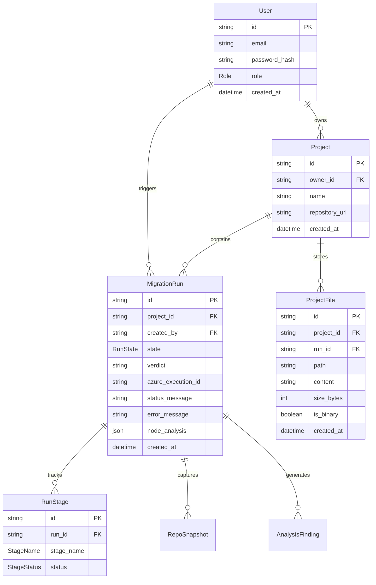

# MigrationGuard — Complete Master Project Context & Handover Document

> **Purpose of this file**: This single document provides any AI coding assistant or IDE (Cursor, Windsurf, VS Code, Claude, JetBrains, etc.) complete end-to-end understanding of **MigrationGuard**: what the platform is, the full technical architecture, everything that has been implemented from scratch to date, the database models, cloud infrastructure, API contracts, and exact operating instructions.

---

## 1. Executive Summary & Project Vision

**MigrationGuard** is an automated, AI-driven cloud migration and verification platform. It allows developers to import repositories (Node.js, Python, full-stack, Java, Dockerized applications), clone them into isolated cloud sandboxes, inspect and store all project source code directly in a serverless database (**Neon PostgreSQL**), run interactive shell commands via an embedded multi-tab **Terminal (CMD)**, and execute multi-agent pipelines (**Camber AI**) to inspect manifests, install dependencies, and automatically fix errors caught by **Sentry**.

### Key Value Propositions
1. **Persistent Cloud State**: Cloned repositories are shredded into a granular `project_files` table in Neon PostgreSQL so work can be paused, inspected, and resumed at any time across sessions or machine restarts without re-cloning.
2. **Isolated Serverless Compute**: Runs compute jobs in **Azure Container Apps Jobs** (Standard Workload Profile, VNet integrated) without maintaining expensive permanent virtual machines.
3. **IDE-Grade Workspace**: 3-column workspace featuring real-time agent changelog, interactive collapsible file tree, syntax-styled code viewer with line numbers, and a dockable multi-tab terminal.
4. **Dual-Agent Autonomous Setup**:
   - **Reading Agent (`Terminal (AI-1)`)**: Reads all repository manifests (`package.json`, `requirements.txt`, `docker-compose.yml`, `.env.example`), builds structured context, and runs dependency installations.
   - **Fixer Agent (`Terminal (AI-2)`)**: Intercepts non-zero exit codes and Sentry errors to diagnose root causes and dispatch remediation commands in parallel.
5. **High-Security Project Deletion**: Permanent deletion is protected by a random 9-character challenge code (e.g. `sTb*6Yrin`) to prevent accidental data loss.

---

## 2. Full Technical Stack

### Frontend
- **Framework**: Next.js 16.4.3 (App Router, Turbopack, React 19)
- **Styling**: Tailwind CSS v4, Lucide Icons, Custom Futuristic Dark Theme (`#0b0f17`, `#0d121d`, Cyan `#22d3ee` accents)
- **Authentication**: Clerk Authentication SDK (`@clerk/nextjs` v7, `@clerk/ui` v1) with dark/shadcn themes and custom session sync
- **Data Fetching & State**: TanStack React Query v5 (`@tanstack/react-query`), `openapi-fetch`
- **Port**: `http://localhost:3000`

### Backend
- **Framework**: FastAPI (Python 3.11), Uvicorn ASGI server
- **Database ORM**: SQLAlchemy 2.0 (asyncio + `asyncpg` driver)
- **Validation**: Pydantic v2 schemas with `ConfigDict(from_attributes=True)`
- **Authentication**: Clerk Session JWT validation + local HS256 JWT fallback; automated user record provisioning
- **Port**: `http://127.0.0.1:8000`

### Database (Neon Serverless PostgreSQL)
- **Provider**: Neon Lakebase PostgreSQL
- **Key Tables**: `users`, `projects`, `migration_runs`, `project_files`, `run_stages`, `findings`, `reports`, `build_runs`, `repo_snapshots`

### Cloud Infrastructure (Microsoft Azure)
- **Subscription**: `dea7d5c6-4a09-488a-9d67-e9445fe6586f` (`Azure for Students`)
- **Resource Group**: `rg-migration-platform` (Region: `Central India`)
- **Virtual Network**: `vnet-migration` (`10.0.0.0/16`)
- **Delegated Subnet**: `snet-aca` (`10.0.0.0/23`, delegated to `Microsoft.App/environments`)
- **Environment**: `env-migration-standard` (Standard Workload Profiles enabled, VNet integrated)
- **Container Apps Job**: `migration-worker` (Trigger: Manual, CPU: 0.25, Memory: 0.5 GiB, timeout: 1800s)
- **Container Registry (ACR)**: `codexa` (`codexa.azurecr.io`)

### Monitoring & Multi-Agent Framework
- **Error Tracking**: Sentry (FastAPI/Python + Next.js) for terminal error logging
- **Multi-Agent Orchestration**: Camber Cloud API (`camber.cloud`) for Reader & Fixer agent coordination

---

## 3. What Has Been Built (Milestones & Evolution from Scratch)

### Milestone 1: Initial Architecture & Clerk Auth Setup
- Scaffolded Next.js App Router application with Clerk authentication.
- Implemented `/sign-in` and `/sign-up` catch-all routes with Clerk dark theme.
- Configured FastAPI backend CORS to accept credentials from `http://localhost:3000`.
- Built backend `current_user` dependency in `backend/auth.py` that decodes Clerk JWT tokens (`sub` starting with `user_`), checks Neon PostgreSQL, and auto-provisions a matching `User` record if it's the user's first login.

### Milestone 2: Azure Infrastructure Provisioning
- Diagnosed and resolved the `ExpressEnvironmentResourceNotSupported` error (Azure blocks Container App Jobs on free/express consumption environments).
- Provisioned a dedicated Virtual Network (`vnet-migration`) and delegated `snet-aca` to `Microsoft.App/environments`.
- Created the Standard Environment `env-migration-standard`.
- Created the Container Apps Job `migration-worker` with manual trigger and injected environment parameters (`JOB_ID`, `BACKEND_URL`, `JOB_TOKEN`).
- Created worker container specifications (`workers/azure_worker/Dockerfile`, `worker.py`, `requirements.txt`).

### Milestone 3: Repository Cloning & Neon Database File Persistence
- Built `backend/repo_service.py` to clone public or private GitHub repos (using user's personal access token or OAuth token).
- Implemented **Database Source Storage**:
  - Recursively walks the cloned tree (ignoring `.git`, `node_modules`, `dist`, `.next`, `venv`, etc.).
  - Distinguishes binary vs text files using UTF-8 / null-byte chunk inspection.
  - Persists all files directly into the `project_files` table in Neon PostgreSQL.
  - Deletes prior runs' files for the same project on re-import to guarantee zero duplication.
- Extended `MigrationRun` state enum in Neon PostgreSQL (`QUEUED`, `STARTING`, `CLONING`, `ANALYZING`, `COMPLETED`, `FAILED`).

### Milestone 4: 3-Column Workspace UI (`/workspace/[id]`)
- Implemented the modern layout:
  - **Top Bar**: Project name, file count in Neon DB, view mode switcher (`Preview` vs `</> Code`), git branch indicator, Neon DB live sync badge, Clerk `UserButton`.
  - **Left Column**: Live stage progress card, detected runtime environment specs (Node.js/Python/Docker), Agent History log, and chat/command input prompt.
  - **Middle Column**: "Files" tree explorer with live text search, hierarchical folder expansion/collapse, and language-specific icons (`.ts`, `.py`, `.json`, `.md`, etc.).
  - **Right Column**: Code viewer with sticky line numbers, syntax highlighting, copy-to-clipboard, and direct file download.

### Milestone 5: Recent Projects Dashboard & Security Protected Deletion
- Fixed React Query hook `useProjects` in `lib/api/hooks.ts` to seamlessly support Clerk authentication (`useAuth()`), ensuring imported projects immediately appear on the Dashboard (`/dashboard`).
- Sorted projects by `created_at DESC` so recent repositories always stay on top.
- Linked cards directly to `/workspace/[id]` with "Open Workspace &rarr;".
- **Random Challenge Security Modal**:
  - Added a trash button to every project card.
  - Clicking it displays an irreversible deletion warning and generates a random 9-character challenge code (e.g., `sTb*6Yrin`).
  - The "Delete permanently" button remains disabled until the code matches character-for-character.
  - When confirmed, `DELETE /api/projects/{id}` deletes all `project_files`, `migration_runs`, `run_stages`, and the project from Neon PostgreSQL.

### Milestone 6: Integrated Multi-Tab Terminal (CMD)
- Added an interactive terminal directly at the bottom of the workspace (collapsible, expandable, maximizable).
- Supported multiple tabs with a **`+`** icon (`Terminal 1`, `Terminal 2`, `Terminal (AI-1)`, `Terminal (AI-2)`).
- Implemented `POST /api/projects/{id}/terminal/execute` in `backend/main.py`:
  - Automatically hydronates project files from Neon DB if local directory is missing.
  - Runs shell commands (e.g. `dir`, `ls`, `pip install`, `npm install`, `python`, `node`, `cat`) with timeout protection.
  - Returns stdout, stderr, and exit codes.
  - Supports command history navigation using **`Up`** and **`Down`** arrow keys.

### Milestone 7: Reading Agent (`AI-1`) & Sentry Fixer Agent (`AI-2`)
- Created `backend/terminal_service.py` with `analyze_project_context()`:
  - Scans all files in Neon DB for manifests (`package.json`, `requirements.txt`, `docker-compose.yml`, `Dockerfile`, `.env.example`).
  - Detects frameworks (Next.js, React, Express, Python Flask/FastAPI, Docker Compose).
  - Determines exact package manager and install commands.
- Added top navbar **"Start Reading Agent"** button:
  - Spawns `Terminal (AI-1)` and executes dependency installation commands one by one.
  - Left chat posts step-by-step progress.
  - If a command fails or non-zero exit code is detected, Sentry intercepts the error, spawns `Terminal (AI-2)`, and executes diagnostic/fixer commands in parallel.

---

## 4. Repository Directory Structure

```text
migration-guard/
├── app/                                # Next.js 16 App Router Frontend
│   ├── dashboard/                      # Dashboard page
│   │   ├── page.tsx                    # Dynamic client wrapper
│   │   └── dashboard-view.tsx          # Dashboard UI with Recent Projects & Delete Modal
│   ├── projects/
│   │   └── new/                        # GitHub repo selection & import page
│   │       └── page.tsx
│   ├── workspace/
│   │   └── [id]/                       # 3-Column Workspace + Terminal UI
│   │       └── page.tsx
│   ├── api/
│   │   └── github/repos/               # GitHub repository fetch proxy
│   ├── sign-in/[[...sign-in]]/         # Clerk Sign-in
│   ├── sign-up/[[...sign-up]]/         # Clerk Sign-up
│   ├── globals.css                     # Tailwind CSS styles
│   ├── layout.tsx                      # Root layout with ClerkProvider & Providers
│   └── page.tsx                        # Landing redirect
│
├── backend/                            # FastAPI Python Backend
│   ├── main.py                         # FastAPI app, API routes & endpoints
│   ├── models.py                       # SQLAlchemy ORM models (Neon PostgreSQL)
│   ├── schemas.py                      # Pydantic v2 schemas
│   ├── config.py                       # App settings (pydantic-settings)
│   ├── db.py                           # Async engine & SessionLocal
│   ├── auth.py                         # Clerk JWT & local token authentication
│   ├── repo_service.py                 # Git clone, file ingestion & Neon persistence
│   ├── terminal_service.py             # Workspace hydration, shell runner & Reading Agent
│   ├── azure_client.py                 # Azure Container Apps Job execution service
│   ├── migration_engine.py             # Migration analysis logic
│   ├── reporting.py                    # Evidence report generator
│   └── verdict.py                      # Migration verification verdict
│
├── workers/                            # Container Apps & Celery Workers
│   ├── azure_worker/                   # Azure Container Apps Job worker
│   │   ├── Dockerfile
│   │   ├── worker.py
│   │   └── requirements.txt
│   └── queue.py
│
├── lib/                                # Frontend Utilities & API Client
│   ├── api/
│   │   ├── client.ts                   # openapi-fetch client with getActiveToken()
│   │   └── hooks.ts                    # TanStack Query hooks (useProjects, useRun, etc.)
│   └── utils.ts                        # Styling & clsx helpers
│
├── .env                                # Root environment variables (Neon DB, Clerk, Azure)
├── package.json                        # Frontend dependencies
├── requirements.txt                    # Backend Python dependencies
└── PROJECT_HANDOVER.md                 # THIS MASTER HANDOVER FILE
```

---

## 5. Database Schema (Neon PostgreSQL)



---

## 6. Primary API Endpoints

| Method | Endpoint | Description |
|---|---|---|
| `GET` | `/health` | Healthcheck (returns `{"status": "ok"}`) |
| `GET` | `/projects` | List projects for authenticated user (`created_at DESC`) |
| `POST` | `/api/projects/import` | Clones repo, saves files to Neon DB, triggers Azure job |
| `DELETE`| `/api/projects/{id}` | Deletes project, runs, and files from Neon DB |
| `GET` | `/api/projects/{id}/workspace`| Returns project metadata, latest run, file count, and file tree |
| `GET` | `/api/projects/{id}/files` | Lists all stored file paths for project |
| `GET` | `/api/projects/{id}/files/content` | Fetches code content of a specific file from Neon DB |
| `POST` | `/api/projects/{id}/terminal/execute` | Executes shell/CMD command inside project workspace |
| `POST` | `/api/projects/{id}/agent/analyze-and-setup` | Reading Agent manifest analysis & dependency plan |
| `GET` | `/runs/{id}/events` | SSE stream for real-time migration stage transitions |

---

## 7. How to Run the Entire Project Locally

### Prerequisites
- Node.js 18+ and `pnpm` or `npm`
- Python 3.11+
- Git CLI and Azure CLI (`az`)

### Step 1: Backend Setup
```powershell
# Navigate to project root
cd e:\Project\migration-guard

# Ensure python dependencies are installed
pip install -r requirements.txt

# Start FastAPI backend
python -m uvicorn backend.main:app --host 127.0.0.1 --port 8000
```
Backend runs at `http://127.0.0.1:8000`.

### Step 2: Frontend Setup
```powershell
# In a second terminal
cd e:\Project\migration-guard

# Start Next.js frontend
npm run dev
```
Frontend runs at `http://localhost:3000`.

---

## 8. Sentry & Camber Integration Variables

Add these to `.env` when connecting the external platforms:

```bash
# Sentry Error Monitoring
SENTRY_DSN=https://<your-key>@<your-org>.ingest.sentry.io/<project-id>
SENTRY_ENVIRONMENT=development

# Camber Multiagent Orchestration
CAMBER_API_KEY=camber_live_your_key_here
CAMBER_WORKSPACE_ID=your_workspace_id
```

---
*Created and verified by Antigravity Engineering for Pair-Programming & Cross-IDE Continuity.*
