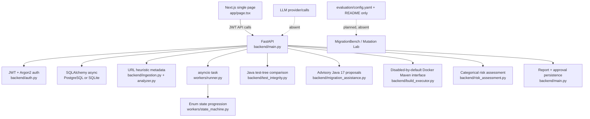

# MigrationGuard project audit

Audit date: 2026-10-28

This audit is based on the source files inspected in this repository. Generated/cache directories (`node_modules`, `.next`, `dist`, `build`, `.git`, `venv`, and `__pycache__`) and lockfile contents were excluded.

## 1. Overview

MigrationGuard is a Next.js preview UI backed by a FastAPI service. The backend has real authentication, project/run persistence, deterministic repository URL metadata analysis, Java test-tree integrity comparison, advisory Java 8-to-17 proposal generation, categorical risk assessment, report persistence, and approval persistence. The repository does **not** yet implement repository cloning, source analysis from checked-out files, automatic migration edits, a real build/test pipeline in the normal run, LLM calls, calibrated verdict logic, GitHub integration, or the documented evaluation runner.

**Overall completion estimate: approximately 35%.** The persisted API skeleton and several deterministic Phase 2–6 components are substantive and unit-tested, but the main user journey stops at synthetic metadata and a state-machine simulation. The worker does not invoke build, integrity, migration-plan, risk, report, or approval operations; the build endpoint explicitly disables execution; and the frontend exposes only login, projects, and a simulated run timeline. The estimate is not a measured project metric.

The project’s own phase documentation is consistent about these limitations: [`docs/README.md`](./README.md) says real sandbox execution, automatic edits, and LLM calls are not implemented.

## 2. Tech stack and repository structure

### Stack

- **Frontend:** Next.js 16, React 19, TypeScript 5.7, Tailwind CSS 4, shadcn/Base UI patterns, Lucide icons, Vercel Analytics; declared in [`package.json`](../package.json), [`app/layout.tsx`](../app/layout.tsx), [`app/globals.css`](../app/globals.css), and [`components.json`](../components.json).
- **Backend:** Python 3.12 in CI, FastAPI, Pydantic 2, SQLAlchemy async, Alembic, JWT, `pwdlib`/Argon2; declared in [`backend/requirements.txt`](../backend/requirements.txt) and used by [`backend/main.py`](../backend/main.py), [`backend/auth.py`](../backend/auth.py), and [`backend/db.py`](../backend/db.py).
- **Storage:** PostgreSQL/Redis are supplied as Docker services, while local settings default to SQLite with `aiosqlite`; see [`docker-compose.yml`](../docker-compose.yml) and [`backend/config.py`](../backend/config.py). Redis is configured but not used by the inspected application code.
- **Tooling:** pnpm is declared in [`package.json`](../package.json); Python commands are exposed by [`Makefile`](../Makefile); CI is in [`.github/workflows/ci.yml`](../.github/workflows/ci.yml).
- **Containers:** no `Dockerfile` was present. [`docker-compose.yml`](../docker-compose.yml) only starts PostgreSQL and Redis.

### Repository tree

```text
app/                    Next.js App Router root page, layout, and global CSS
backend/                FastAPI API, auth, SQLAlchemy models, analysis, migration, risk, and migrations
backend/alembic/        Alembic environment and six revision files
components/ui/          One reusable Base UI button component
docs/                   API export, phase/run instructions, and this audit
evaluation/             Evaluation README/config only; no runner or metrics implementation
lib/                    Frontend API client, shared TypeScript types, and class-name utility
public/                 Icons and placeholder image assets
tests/                  Python unit tests for deterministic modules and security/auth basics
workers/                In-process run state machine and runner
.github/workflows/      Python CI workflow
```

No `pyproject.toml`, root `requirements.txt`, Maven project, `Dockerfile`, GitHub client module, or CLI entry point was found.

## 3. Architecture and how it works

The browser calls the FastAPI API directly using `NEXT_PUBLIC_API_URL` (defaulted in [`lib/api/client.ts`](../lib/api/client.ts)). FastAPI creates users, projects, and runs in SQLAlchemy tables. Creating a run starts an `asyncio.create_task` in [`create_run`](../backend/main.py), which writes a synthetic repository snapshot and findings through [`create_snapshot_and_findings`](../backend/ingestion.py), then calls [`advance_run`](../workers/runner.py). The runner advances enum states on a timer; it does not execute the later analysis/build/report phases. Separate endpoints expose deterministic utilities, but the frontend does not call them.



## 4. Frontend

### Pages and components

| Surface | Status | Evidence |
|---|---|---|
| `/` login form | ✅ Implemented | [`Page`](../app/page.tsx) renders email/password fields and calls `apiClient.login`. |
| Authenticated project list | ✅ Implemented | [`Page`](../app/page.tsx) loads `/projects`, selects a project, and shows repository URLs. |
| Project creation | ✅ Implemented | [`Page`](../app/page.tsx) opens a form and calls `apiClient.createProject`. |
| Start run and timeline | 🟡 Partial | [`startRun`](../app/page.tsx) calls the real create-run endpoint and polls `/runs/{id}`, but the displayed pipeline is only state polling and the backend worker is synthetic. |
| Run details/findings | ❌ Missing in UI | The client has `getRunDetails` and `getFindings` in [`client.ts`](../lib/api/client.ts), but [`page.tsx`](../app/page.tsx) never calls or renders them. |
| Migration plan, build results, risk, report, approval | ❌ Missing in UI | Client methods/types for a report are present in [`client.ts`](../lib/api/client.ts) and [`types.ts`](../lib/types.ts), but no page controls or views use them. |
| Multiple routes/screens | ❌ Missing | Only [`app/page.tsx`](../app/page.tsx) exists under `app/`; no route folders for reports, approvals, settings, or administration were found. |
| State management | ✅ Implemented, limited | Local React `useState`, `useMemo`, and `useEffect` in [`page.tsx`](../app/page.tsx); no Redux, Zustand, context, persistence, or cache layer was found. |
| API client | ✅ Implemented, incomplete coverage | [`lib/api/client.ts`](../lib/api/client.ts) has typed fetch helpers for auth, projects, runs, findings, events, and reports, with status/error handling. It lacks calls for build, integrity, migration plan, risk, and approval. |
| Mock data | 🎭 Mock/Stub | The UI defaults to `developer@example.com`, `migrationguard`, and `https://github.com/acme/example` in [`page.tsx`](../app/page.tsx). These are form defaults, not fetched data; no mock data file was found. |
| Theme/UI | ✅ Implemented | Dark-first styling and Tailwind/shadcn imports are in [`globals.css`](../app/globals.css); Base UI button and Lucide icons are used in [`button.tsx`](../components/ui/button.tsx) and [`page.tsx`](../app/page.tsx). |

The frontend TypeScript model is ahead of the backend: [`lib/types.ts`](../lib/types.ts) defines verdicts, a richer pipeline (`PLANNING`, `MIGRATING`, `TEST_INTEGRITY`, etc.), numeric risk scores, and evidence sources, while [`backend/models.py`](../backend/models.py) has only enum states and a string risk score. This is an unverified runtime mismatch because the frontend does not currently consume those fields.

## 5. Backend endpoints

The table below is from route decorators in [`backend/main.py`](../backend/main.py), not only the checked-in OpenAPI export. The checked-in [`docs/openapi.json`](./openapi.json) is stale: it lists only `/health`, auth, projects, basic run, and events paths, omitting the detail, snapshot, findings, build, integrity, plan, risk, report, and approval endpoints.

| Method | Path | Purpose | Status | File |
|---|---|---|---|---|
| GET | `/health` | Health response | ✅ Implemented | [`health`](../backend/main.py) |
| POST | `/auth/register` | Create developer user and JWT | ✅ Implemented | [`register`](../backend/main.py), [`auth.py`](../backend/auth.py) |
| POST | `/auth/login` | Verify password and issue JWT | ✅ Implemented | [`login`](../backend/main.py), [`auth.py`](../backend/auth.py) |
| POST | `/projects` | Create owned project | ✅ Implemented | [`create_project`](../backend/main.py) |
| GET | `/projects` | List caller-owned projects | ✅ Implemented | [`list_projects`](../backend/main.py) |
| POST | `/projects/{project_id}/runs` | Persist run, enqueue in-process task | 🟡 Partial | [`create_run`](../backend/main.py) |
| GET | `/runs/{run_id}` | Get owned run state | ✅ Implemented | [`get_run`](../backend/main.py) |
| GET | `/runs/{run_id}/details` | Get run, latest project snapshot, findings | 🟡 Partial | [`get_run_details`](../backend/main.py) |
| GET | `/runs/{run_id}/snapshot` | Get project snapshot | 🟡 Partial | [`get_snapshot`](../backend/main.py) |
| GET | `/runs/{run_id}/findings` | Get persisted analysis findings | ✅ Implemented | [`get_findings`](../backend/main.py) |
| GET | `/runs/{run_id}/events` | SSE stream | 🟡 Partial | [`run_events`](../backend/main.py) emits one current event only. |
| POST | `/runs/{run_id}/build` | Record Maven build result | 🎭 Mock/Stub | [`build_run`](../backend/main.py) hardcodes `docker_enabled=False` and uses a fixed synthetic path. |
| POST | `/runs/{run_id}/test-integrity` | Compare caller-supplied Java test trees | ✅ Implemented, scoped | [`test_integrity`](../backend/main.py), [`test_integrity.py`](../backend/test_integrity.py); results are returned, not persisted. |
| GET | `/runs/{run_id}/migration-plan` | Persist and return advisory proposals | 🟡 Partial | [`migration_plan`](../backend/main.py), [`migration_assistance.py`](../backend/migration_assistance.py); no files are changed. |
| POST | `/runs/{run_id}/assess-risk` | Persist categorical risk | 🟡 Partial | [`assess_risk`](../backend/main.py), [`risk_assessment.py`](../backend/risk_assessment.py). |
| GET | `/runs/{run_id}/report` | Create/read a JSON report | 🟡 Partial | [`get_report`](../backend/main.py); no verdict/evidence report is generated. |
| POST | `/runs/{run_id}/approval` | Persist approved/rejected decision and audit row | 🟡 Partial | [`approve_run`](../backend/main.py); it does not update run state or enforce approver role. |

## 6. Core modules status

| Module | Status | Evidence | What is missing |
|---|---|---|---|
| Repository ingestion | 🟡 Partial | [`create_snapshot_and_findings`](../backend/ingestion.py) calls analysis and stores a snapshot. | No clone, commit resolution, archive upload, filesystem snapshot, or repository credentials; `commit_sha` is the literal `"phase2-stub"`. |
| Java/version/dependency analysis | 🟡 Partial | [`analyze_repository`](../backend/analyzer.py) parses the URL and infers Maven/Java from the repository name or URL text. | It does not inspect `pom.xml`, Java source, versions, dependency graph, or actual repository contents. |
| Migration engine/OpenRewrite | 🎭 Mock/Stub | [`build_java17_plan`](../backend/migration_assistance.py) returns two hardcoded proposal objects and diff text. | No OpenRewrite dependency, rule execution, source edits, patch application, compile validation, or rollback. |
| LLM layer | ❌ Missing | [`docs/README.md`](./README.md) and [`evaluation/config.yaml`](../evaluation/config.yaml) explicitly say LLM calls are not implemented; no provider import or call site was found. | Provider configuration, prompt boundary, evidence storage, failure handling, and provider-independent guardrails. |
| Docker sandbox/build runner | 🟡 Partial | [`run_maven_build`](../backend/build_executor.py) has a bounded Docker command with no network, CPU/memory limits, read-only mount, timeout, and output capture. | The API always disables it; no snapshot exists at the fixed path; no artifact collection; no production worker/queue. |
| Surefire/JUnit result parsing | ❌ Missing | No parser or Surefire XML handling was found; the migration proposal only asks for a dependency review. | XML ingestion, test-level results, flaky/error distinction, and persistence. |
| Test integrity | ✅ Implemented, scoped | [`parse_test_tree`](../backend/test_integrity.py) and [`compare_test_trees`](../backend/test_integrity.py) detect deleted files/tests, newly disabled files, reduced assertions, and total test-count drops below 80%; tests cover core cases. | It is text/regex-based, only recognizes Java patterns, accepts arbitrary client-supplied trees, and does not compare actual repository revisions or persist findings. |
| Regression checks | ❌ Missing | No regression module or endpoint was found. | Baseline/migrated execution comparison, behavioral checks, and evidence linkage. |
| Risk scoring | 🟡 Partial | [`assess_run`](../backend/risk_assessment.py) returns `LOW`, `MEDIUM`, or `HIGH` from findings/integrity/build status. | No numeric/calibrated probability; build status is normally absent; no regression or migration evidence is included. |
| Verdict logic | ❌ Missing | Verdict literals exist only in [`lib/types.ts`](../lib/types.ts); backend has no `Verdict` model/function and reports contain risk/status only. | Deterministic verdict policy that cannot be overridden by LLM output and is tied to complete evidence. |
| Report generation | 🟡 Partial | [`get_report`](../backend/main.py) persists a small JSON object after risk assessment. | No generated evidence list, diff, test/build result, verdict, provenance, or report UI. |
| Approvals | 🟡 Partial | [`approve_run`](../backend/main.py) validates decision/state and writes [`Approval`](../backend/models.py) plus [`AuditLog`](../backend/models.py). | No role restriction, state transition after decision, idempotency, or UI. |
| GitHub integration/CLI | ❌ Missing | Only example GitHub URLs and text references were found; no GitHub client, webhook, token flow, or CLI exists. | Repository access, status checks, PR/commit integration, and command-line interface. |

## 7. Database schema summary

SQLAlchemy models are defined in [`backend/models.py`](../backend/models.py); runtime startup creates all metadata in [`lifespan`](../backend/main.py). Tables and key relationships:

- `users`: users, email, password hash, role.
- `projects`: owned by `users`; optional repository URL.
- `repo_snapshots`: belongs to a project; stores commit SHA and JSON metadata.
- `migration_runs`: belongs to a project and creator user; stores `RunState`.
- `migration_changes`: belongs to a run; advisory/reversible proposal diff metadata.
- `analysis_findings`: belongs to a run; severity/message.
- `test_cases`: belongs to a project; JSON definition.
- `test_results`: joins a run to a test case.
- `build_runs`: belongs to a run; status, exit code, logs, artifacts.
- `risk_assessments`: belongs to a run; string score and rationale.
- `reports`: belongs to a run; JSON content.
- `approvals`: joins a run and user; decision.
- `test_integrity_results`: belongs to a run; code/severity/path/message.
- `audit_log`: optional user/entity references plus action/details JSON.

Alembic revision `0001_initial` is a no-op in [`0001_initial.py`](../backend/alembic/versions/0001_initial.py), while later revisions add indexes/columns/tables. Therefore runtime `create_all` is the actual local schema bootstrap; a fresh database using only `alembic upgrade head` cannot be assumed to receive the base tables.

## 8. AI/LLM usage and guardrails

**Provider/call sites:** ❌ Missing. No SDK, API key setting, provider class, prompt, or LLM call was found. The `llm_only` system in [`evaluation/config.yaml`](../evaluation/config.yaml) is configuration text only.

**Current guardrails:** The deterministic migration proposals are explicitly advisory and reversible in [`migration_assistance.py`](../backend/migration_assistance.py), and the evaluation notes say deterministic checks decide verdicts and LLM outputs remain unverified evidence in [`evaluation/config.yaml`](../evaluation/config.yaml). Since no LLM exists, it currently cannot influence the verdict—but the backend also has no implemented verdict. Any future LLM integration must preserve this boundary and never allow model output to approve a run.

The project correctly describes risk scores as explainable heuristics, not calibrated probabilities in [`evaluation/README.md`](../evaluation/README.md). The API’s current `LOW/MEDIUM/HIGH` string is safer than exposing a probability, but the frontend’s `riskScore: number` type in [`lib/types.ts`](../lib/types.ts) is inconsistent and should not be presented as a probability.

## 9. Evaluation module status

| Capability | Status | Evidence |
|---|---|---|
| MigrationBench integration | 🎭 Mock/Stub | [`evaluation/README.md`](../evaluation/README.md) and [`config.yaml`](../evaluation/config.yaml) name a benchmark and subset, but no `run.py`, downloader, adapter, or data exists. |
| Mutation Lab | 🎭 Mock/Stub | README describes labeled variants, but there is no mutation generator or runner file. |
| Four-system comparison | ❌ Missing | Names are listed in [`config.yaml`](../evaluation/config.yaml); no implementations for plain build/test, OpenRewrite, LLM-only, or MigrationGuard evaluation were found. |
| Metrics scripts | ❌ Missing | No metrics, CSV/PNG writer, or analysis script exists. |
| Result outputs | ❌ Missing | No `results/` directory or generated artifacts were present. |

The planned command `python -m evaluation.run --config evaluation/config.yaml --max_workers 2` cannot work because `evaluation/run.py` is absent.

## 10. End-to-end flow: where real vs mock begins

1. **Submit credentials:** Real route and Argon2 password verification in [`auth.py`](../backend/auth.py) and [`main.py`](../backend/main.py).
2. **Create project:** Real authenticated, owner-scoped database write in [`create_project`](../backend/main.py).
3. **Start run:** Real `MigrationRun` database write in [`create_run`](../backend/main.py).
4. **Ingest repository:** **Mock/partial boundary.** The background task does not clone the URL. [`analyze_repository`](../backend/analyzer.py) infers metadata from URL text and [`ingestion.py`](../backend/ingestion.py) stores `"phase2-stub"` as the commit SHA.
5. **Advance lifecycle:** **Synthetic.** [`advance_run`](../workers/runner.py) changes enum values every 50 ms; it does not execute analysis, test integrity, build, migration, risk, or report stages.
6. **Build/tests/migration:** Separate endpoints contain limited deterministic or stub behavior, but the normal run never calls them. Build is explicitly `SKIPPED` unless two gates are enabled, and the endpoint passes `docker_enabled=False` in [`main.py`](../backend/main.py).
7. **Risk/report:** These are real persistence endpoints when called manually, but risk is categorical and the report is a small JSON wrapper, not a complete verification report.
8. **Approval:** The approval row and audit log are real when called, but approval does not change run state and is not exposed by the UI.

Consequently, the first non-real step is repository ingestion, and the normal run becomes clearly synthetic at lifecycle progression.

## 11. How to run locally and verification performed

Declared commands:

```text
make install
make up
make api
make test
make openapi
pnpm dev
pnpm build
```

Observed checks in this environment:

- `docker compose config`: **passed** (exit code 0). The compose file defines PostgreSQL and Redis with health checks.
- `PYTHONPATH=. pytest -q`: **failed during collection**. Installed environment lacks `pwdlib` and `aiosqlite`; pytest also reported unknown `asyncio_mode` and `asyncio_default_fixture_loop_scope`, indicating the installed pytest environment lacks the configured async plugin.
- Focused deterministic tests (`test_analyzer.py`, `test_build_executor.py`, `test_integrity.py`, `test_migration_assistance.py`): **6 passed, 1 failed**. The build test could not execute because async test support is missing; the test itself expects the disabled-by-default result.
- `python -m backend.export_openapi`: **failed** on missing `aiosqlite` while importing [`backend/db.py`](../backend/db.py).
- `pnpm build`: **could not start**; the local pnpm 12.3.4 shim reported that its target executable was not recognized.
- CI’s declared install/test/OpenAPI sequence is in [`.github/workflows/ci.yml`](../.github/workflows/ci.yml), but it was not run in GitHub during this audit.

After installing the exact declared Python and Node dependencies, the intended local sequence is `make install`, `make up`, `make api` in separate terminals, then `make test`; however, this audit does not claim those commands pass because the required dependencies/services were not available here.

## 12. Gaps, risks, and bugs

### Critical

1. **The displayed run can reach approval without doing verification.** [`workers/runner.py`](../workers/runner.py) only calls [`next_state`](../workers/state_machine.py), so the state machine can reach `AWAITING_APPROVAL` without build, test integrity, migration, regression, risk, or report evidence.
2. **Fresh Alembic deployments are unsafe/unverified.** [`0001_initial.py`](../backend/alembic/versions/0001_initial.py) has empty `upgrade`/`downgrade`; only runtime `create_all` in [`main.py`](../backend/main.py) creates tables.
3. **Build endpoint reports a successful-looking skipped result.** [`build_run`](../backend/main.py) stores the `SKIPPED` result from [`run_maven_build`](../backend/build_executor.py), but there is no endpoint contract preventing a caller from treating exit code 0 as successful verification.
4. **Repository input is not actually verified.** URL-name heuristics in [`analyzer.py`](../backend/analyzer.py) can label arbitrary URLs as Java/Maven without fetching or inspecting source.

### Important

1. **Authorization roles are not enforced for approvals or other privileged actions.** [`require_roles`](../backend/auth.py) exists but is unused; [`approve_run`](../backend/main.py) accepts any owner regardless of role.
2. **Public registration accepts a role field but silently ignores it.** [`UserCreate`](../backend/schemas.py) exposes `role`, while [`register`](../backend/main.py) always stores developer. This is least-privilege behavior but an API contract inconsistency.
3. **Default development secrets are weak if deployed incorrectly.** [`backend/config.py`](../backend/config.py) defaults to `local-development-only-change-me`; [`docker-compose.yml`](../docker-compose.yml) uses fixed database credentials. Production JWT validation exists, but deployment must ensure `APP_ENV=production`.
4. **No durable queue or retry semantics.** [`create_run`](../backend/main.py) uses `asyncio.create_task`; process loss loses the worker task and there is no Redis queue despite Redis being configured.
5. **SSE is not a live event stream.** [`run_events`](../backend/main.py) yields one event using the state captured when the request starts and then closes.
6. **Snapshot association is too coarse.** [`RepoSnapshot`](../backend/models.py) belongs to a project, not a run; `get_snapshot` and `get_run_details` select a project snapshot, so concurrent runs can receive the wrong snapshot.
7. **Report lacks the product’s central verdict/evidence contract.** [`ReportOut`](../backend/phase6_schemas.py) returns arbitrary JSON and [`get_report`](../backend/main.py) writes only risk/rationale/status.
8. **Checked-in OpenAPI is stale.** [`docs/openapi.json`](./openapi.json) omits routes present in [`main.py`](../backend/main.py), and export could not be regenerated in the current environment.
9. **Test integrity is caller-supplied and regex-based.** [`IntegrityCheckRequest`](../backend/phase4_schemas.py) accepts arbitrary file maps; [`test_integrity.py`](../backend/test_integrity.py) does not parse Java ASTs, execute tests, or persist results.
10. **Frontend/backend contracts diverge.** [`lib/types.ts`](../lib/types.ts) models verdicts and numeric risk while backend models expose neither; the UI also never renders report, findings, or approval data.

### Nice-to-have

1. Add password length/rate limiting and login audit/lockout controls.
2. Add database constraints/indexes/unique policies for one approval and run-scoped snapshot selection.
3. Add API integration tests for ownership, auth, lifecycle, report, approval, and stale/concurrent runs.
4. Add frontend route-level tests and accessible form/modal behavior.
5. Add structured logging, correlation IDs, and explicit failure states.
6. Add the documented evaluation runner and reproducible result artifacts.

No code path inspected deletes or weakens tests automatically; the migration proposal module only returns advisory text. The main rule violation is indirect: the run lifecycle can present an approval-ready state without having run the required checks, and the current implementation has no verdict guard that would prevent that.

## 13. Recommended next 10 steps in build order

1. Replace the no-op base Alembic revision with a complete schema migration and test fresh-database upgrades.
2. Implement durable run orchestration with a real queue/worker, persisted stage transitions, retries, failure states, and idempotency.
3. Implement secure repository ingestion: validate allowed Git URLs, clone a pinned commit into an isolated workspace, and associate the snapshot with the run.
4. Replace URL heuristics with actual `pom.xml`/Java source analysis and persist provenance.
5. Wire deterministic test-integrity, build/test execution, Surefire parsing, and regression checks into the worker; never treat `SKIPPED` as pass.
6. Implement a deterministic verdict policy from complete evidence, explicitly independent of any LLM, and keep risk scores labeled as heuristics.
7. Add OpenRewrite or another real migration engine behind reviewable, reversible patches; never apply changes or alter tests automatically.
8. Add report/evidence schemas and approval authorization/state transitions, then regenerate and validate OpenAPI.
9. Bring the frontend/API contracts together and add findings, plan, build, risk, report, and approval screens.
10. Implement the MigrationBench/Mutation Lab runner, metrics, artifact outputs, integration tests, security tests, and CI coverage for the full lifecycle.
